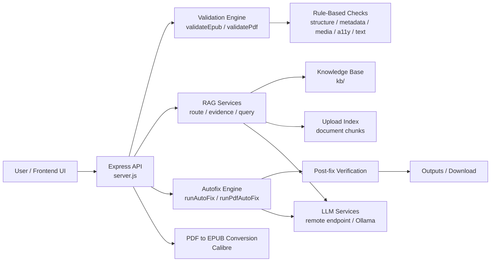
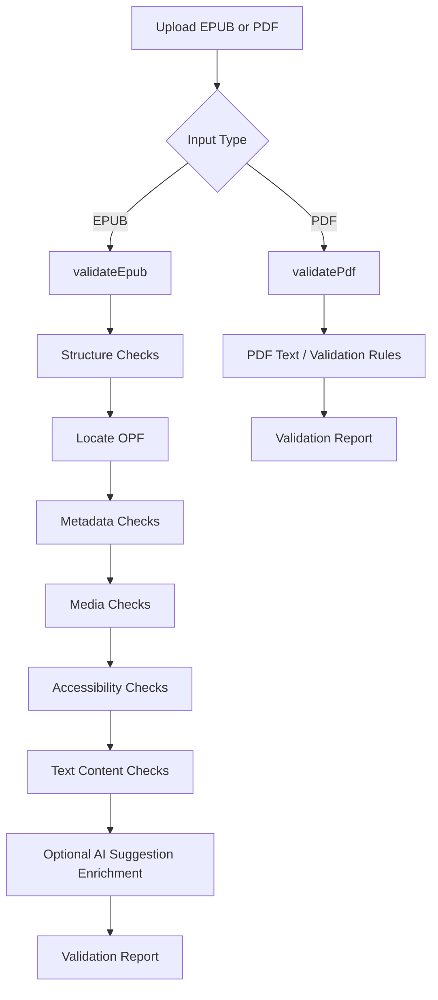
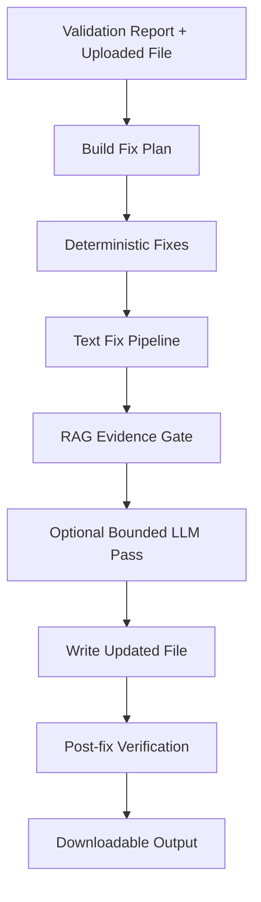
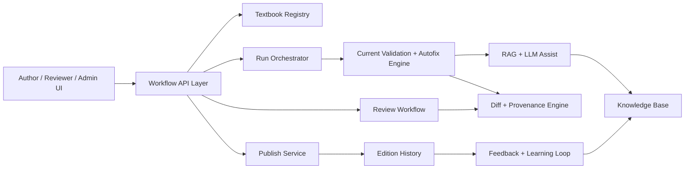
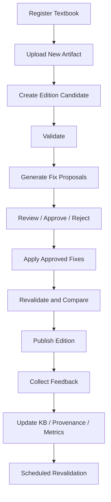

# Architecture Block Diagram Document

## Scope

This document provides:

- the current high-level architecture block diagram
- the current validation and autofix flow
- the target "Living Textbook" architecture block diagram
- the gap between the current system and the target platform

This is intended to be easier to present than the detailed HLD.

## 1. Current Architecture

### 1.1 System Context



### 1.2 Runtime Block View

```text
+---------------------+
| User / Frontend     |
| Upload + Review     |
+----------+----------+
           |
           v
+---------------------+
| API Layer           |
| server.js           |
+----------+----------+
           |
           +-------------------+-------------------+
           |                   |                   |
           v                   v                   v
+----------------+   +----------------+   +----------------+
| Validation     |   | RAG Services   |   | PDF Conversion |
| Engine         |   |                |   | Calibre        |
+--------+-------+   +--------+-------+   +----------------+
         |                    |
         v                    v
+----------------+   +------------------------+
| Rule Engines   |   | KB + Upload Index      |
| checks/*       |   | local retrieval        |
+--------+-------+   +-----------+------------+
         |                       |
         +-----------+-----------+
                     |
                     v
           +----------------------+
           | Autofix Engine       |
           | deterministic + LLM  |
           +----------+-----------+
                      |
                      v
           +----------------------+
           | Post-fix Verification|
           +----------+-----------+
                      |
                      v
           +----------------------+
           | Outputs / Download   |
           +----------------------+
```

### 1.3 Internal Validation Flow



### 1.4 Autofix Flow



## 2. Current Responsibility Split

### 2.1 Rule-Based Logic

Used for:

- EPUB package structure validation
- OPF, manifest, spine, nav, and NCX validation
- metadata checks
- most accessibility checks
- media checks
- initial text anomaly detection
- deterministic autofixes
- post-fix verification

### 2.2 RAG Logic

Used for:

- issue routing
- evidence planning
- upload indexing
- KB retrieval
- supporting ambiguous text corrections
- gating whether a candidate text fix is safe enough to apply

### 2.3 LLM Logic

Used for:

- bounded suggestion generation
- ambiguous text correction assistance
- limited alt-text style assistance

The LLM is not the primary validation engine.

## 3. Current Architecture Limitations

The current system is still a stateless execution backend.

Missing platform components:

- textbook registry
- edition/version history
- persistent run history
- diff and provenance tracking
- review and approval workflow
- publish and rollback lifecycle
- feedback loop from user/editor decisions
- scheduled revalidation

## 4. Target Living Textbook Architecture

### 4.1 Target System Context



### 4.2 Target Runtime Block View

```text
+------------------------+
| Author / Reviewer UI   |
+-----------+------------+
            |
            v
+------------------------+
| Workflow API Layer     |
| validate / review /    |
| publish / history      |
+-----------+------------+
            |
            +-------------------+-------------------+-------------------+
            |                   |                   |                   |
            v                   v                   v                   v
+----------------+   +----------------+   +----------------+   +----------------+
| Textbook       |   | Run / Job      |   | Review         |   | Publish        |
| Registry       |   | Orchestrator   |   | Workflow       |   | Service        |
+--------+-------+   +--------+-------+   +--------+-------+   +--------+-------+
         |                    |                    |                    |
         +--------------------+----------+---------+--------------------+
                                       |
                                       v
                           +-------------------------+
                           | Current Validation and  |
                           | Autofix Engine          |
                           +------------+------------+
                                        |
                          +-------------+-------------+
                          |                           |
                          v                           v
               +--------------------+     +-----------------------+
               | RAG + LLM Assist   |     | Diff / Provenance     |
               | KB + upload ctx    |     | file/chapter/snippet  |
               +----------+---------+     +-----------+-----------+
                          |                           |
                          v                           v
               +--------------------+     +-----------------------+
               | Knowledge Base     |     | Edition History       |
               | standards/examples |     | snapshots/releases    |
               +----------+---------+     +-----------+-----------+
                          |                           |
                          +-------------+-------------+
                                        |
                                        v
                           +-------------------------+
                           | Feedback / Learning     |
                           | approved fixes, FP logs |
                           +-------------------------+
```

### 4.3 Living Textbook Lifecycle



## 5. How the Current Architecture Evolves

The cleanest approach is not to replace the current backend.

The current backend should become the core execution engine inside a larger textbook lifecycle platform.

### Keep

- validation engine
- deterministic rule checks
- autofix engine
- RAG evidence layer
- LLM bounded assistance
- post-fix verification

### Add

- textbook registry
- edition model
- run history
- review workflow
- diff/provenance service
- publish/rollback service
- feedback ingestion
- scheduled revalidation

## 6. Recommended New Modules

Suggested new backend modules:

```text
src/
  textbooks/
  editions/
  runs/
  review/
  publish/
  history/
  analytics/
```

These modules should wrap the existing validation/autofix pipeline rather than rewrite it.

## 7. Executive Summary

### Current State

The current system is an AI-assisted EPUB/PDF validation and autofix backend with:

- deterministic conformance checks
- RAG-supported evidence retrieval
- bounded LLM assistance
- post-fix verification

### Target State

The Living Textbook version of this product adds:

- persistent textbook identity
- edition/version management
- reviewable and traceable changes
- publishing and rollback
- continuous learning from approved corrections and feedback

In short:

```text
Current system  = validation and correction engine
Target system   = governed, versioned, continuously improving textbook platform
```

